# 🌱 스마트팜 IoT — 아두이노 2대로 만든 자동화 비닐하우스

> 2024년 1학기 서원대학교 컴퓨터공학과 **IoT 기초실험** 팀 프로젝트
> 🏆 **수업 1등 · IoT 전시회 1등** → 학과 홍보영상에 소개

<p align="center">
  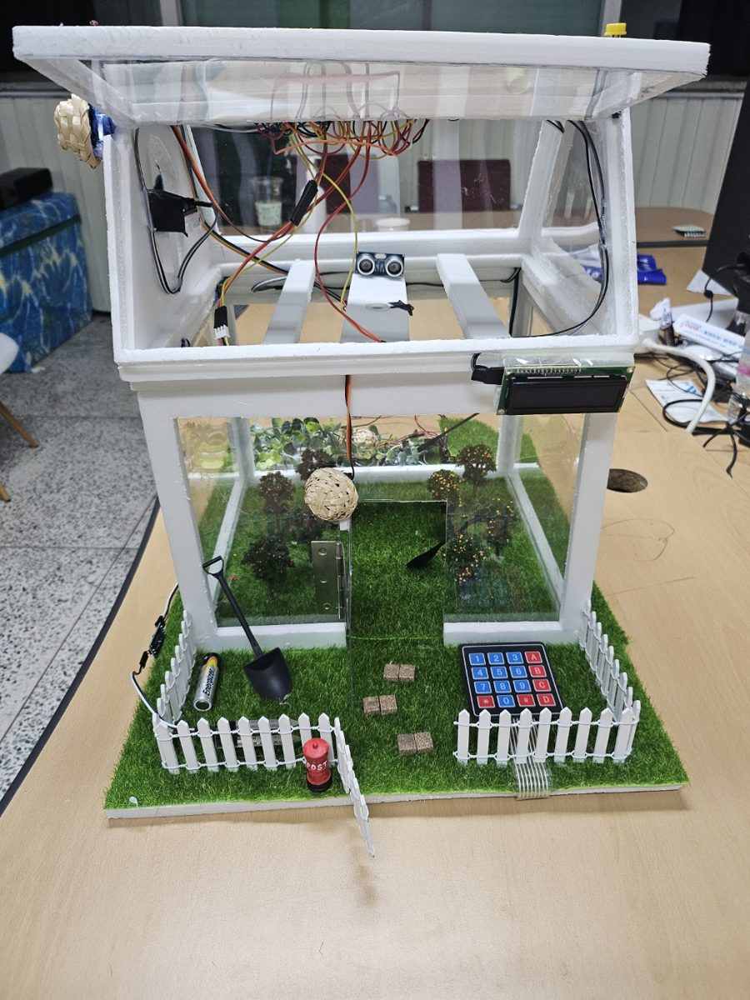
  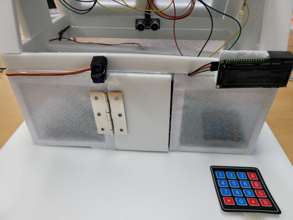
</p>
<p align="center"><sub>왼쪽: 2024-08 홍보영상용 재제작(v2) · 오른쪽: 2024-06 전시회 버전(v1)</sub></p>

비닐하우스 모양의 작은 농장에 **아두이노 우노 2대**(천장 / 바닥)를 넣어,
햇빛에 따라 지붕 창문이 열리고, 흙이 마르면 물을 주고, 작물이 다 자라면 수확 시기를 알려 주며,
비밀번호를 틀리게 누르면 휴대폰 앱으로 **"침입자 발생"** 음성 알림을 보내는 스마트팜입니다.

- **기간**: 2024.05 ~ 2024.06 (1학기 전시회) · 2024.07 ~ 2024.08 (홍보영상용 재제작)
- **사용 기술**: Arduino (C/C++) · MIT App Inventor · Bluetooth (HC-06) · 센서 9종 · 서보 2개
- **내 역할**: 팀장 — 아두이노 펌웨어 전체, 회로 설계·배선, 앱 동작 로직(블록 코딩)

> ℹ️ 이 저장소는 2024년에 작업한 코드와 자료를 2026년에 복원해 올린 것입니다.
> 코드 커밋의 날짜는 **실제 파일 작성일**에 맞췄고, README·회로도·사진 정리는 2026년에 추가했습니다.

---

## 🎬 학과 홍보영상 소개

수업 1등을 계기로 교수님 요청을 받아, 전시 후 분해했던 작품을 2024년 8월에 다시 만들었고
**서원대학교 공식 유튜브 학과 소개 영상**에 소개되었습니다.
재제작 때는 외관을 투명 아크릴로 바꾸고 **네오픽셀 생장등 60구**와 **환풍 팬 버튼**을 추가했습니다.

▶ **[컴공과 갈공대? [서원대학교 컴퓨터공학과] | 지헌왔서원 ep.5](https://www.youtube.com/watch?v=jDWBZ_4Mgno&t=250s)** — 4:10 ~ 5:14

> 재제작은 제가 총괄해 완성했지만, 촬영 당일 급한 일정이 생겨 영상에는 팀원 **문효원 · 이호현**이 출연해 작품을 설명했습니다.

영상은 짧은 학과 소개 코너라 **수확 시기 알림**과 **빛에 따라 움직이는 지붕 창문** 두 가지만 간단히 소개되었지만,
실제 작품에는 아래 기능들이 모두 들어 있습니다.

---

## ✨ 주요 기능

| | 기능 | 동작 | 사용 부품 |
|---|---|---|---|
| 🔐 | **보안 출입문** | `5` 키를 누른 뒤 비밀번호 4자리 입력 → 맞으면 서보가 문을 2초간 열었다 닫음, 틀리면 부저 2초 + 앱에 침입 알림 | 키패드, 서보, 부저 |
| 📱 | **침입 알림 앱** | 블루투스로 `"1"`을 받으면 "침입자 발생" 표시 + TTS 음성 "침입자가 발생하였습니다" | HC-06, App Inventor |
| 🌡️ | **온습도 모니터링** | 5초마다 온습도를 측정해 앱으로 전송 | DHT11 |
| ☀️ | **자동 지붕 창문** | 밝은 상태가 3초 이상 이어지면 지붕 창문을 130° 열고 조명 끔 / 어두우면 창문을 닫고 조명 켬 | 조도 센서, 서보, LED·네오픽셀 |
| 💧 | **자동 급수** | 토양 수분이 낮으면 가습기 모듈로 분무 | 토양 수분 센서, 가습기 모듈 |
| 🌾 | **수확 시기 알림** | 초음파 센서로 작물 높이를 재서, 작물이 기준 높이까지 5초 이상 자라 있으면 부저 + LCD `Harvest time!` | 초음파 센서, I2C LCD |
| 🌀 | **환풍 팬** | 불꽃 센서 반응 시 팬 동작(바닥) · 버튼으로 팬 ON/OFF(천장, v2) | 불꽃 센서, DC 팬, 버튼 |
| 💡 | **실내 조명** | 바닥 조도 센서가 어두우면 LED 점등 | 조도 센서, LED |

### 시연

| 보안 출입문 | 자동 지붕 창문 | 자동 급수 |
|:---:|:---:|:---:|
| 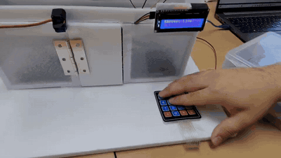 | 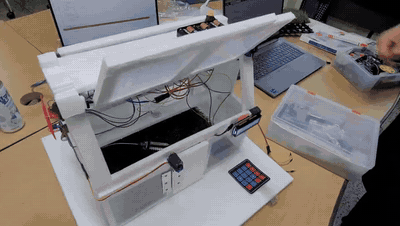 | 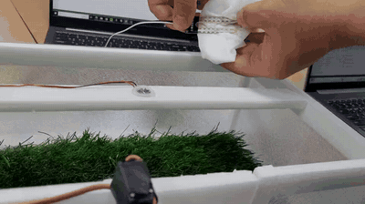 |
| **수확 시기 알림** | **앱 연동 (v1, 전시회)** | **앱 연동 (v2, 방학)** |
| 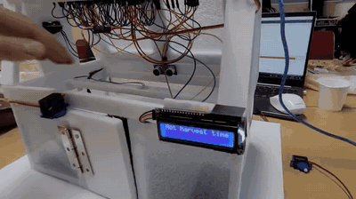 | 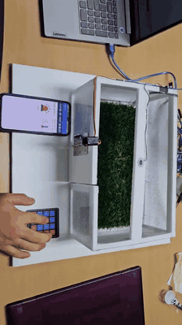 | 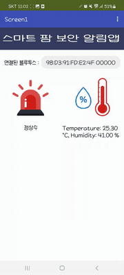 |

<sub>v2 앱 영상: 정상 → 비밀번호 오류 시 <b>"침입자 발생"</b> → 온습도 <code>25.3 °C / 41 %</code> 수신</sub>

---

## 🏗️ 시스템 구조

천장(지붕)과 바닥을 **서로 독립된 아두이노 2대**로 나눴습니다.
지붕 창문은 위로 열려야 해서 선을 바닥까지 끌고 내려오기 어려웠기 때문에,
햇빛 감지·창문 서보·수확 알림은 **건전지로 동작하는 천장 보드**에 따로 두고, 나머지는 바닥 보드에 모았습니다.

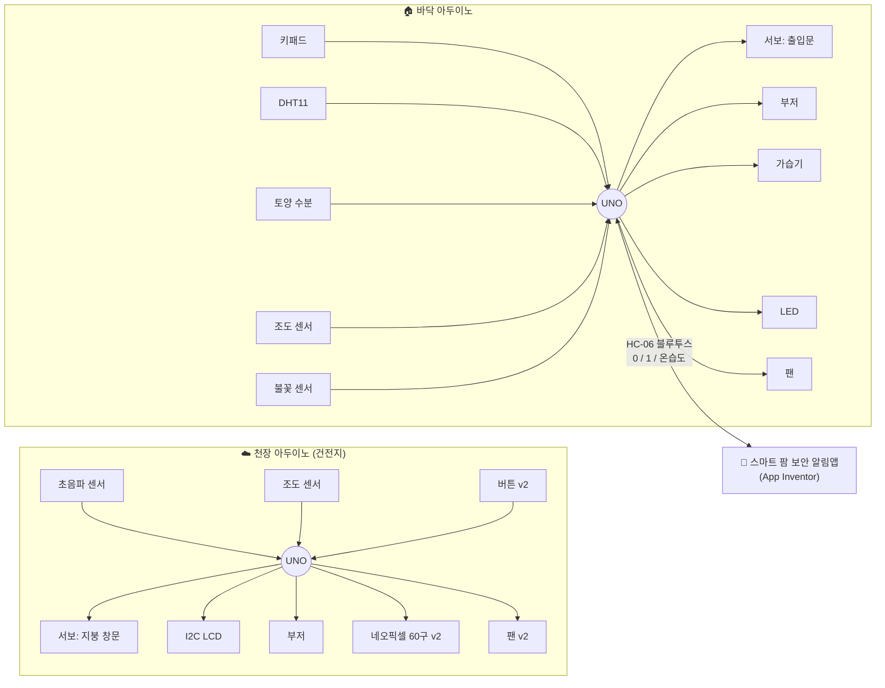

### 블루투스 통신 규칙

| 바닥 아두이노 → 앱 | 의미 | 앱 동작 |
|---|---|---|
| `0` | 비밀번호 일치 | "정상" 표시 |
| `1` | 비밀번호 불일치 | "침입자 발생" 표시 + TTS 음성 안내 |
| 그 외 문자열 | 온습도 값 | 온도계·물방울 아이콘 아래에 표시 |

앱은 `Clock` 타이머로 수신 버퍼를 주기적으로 확인(`BytesAvailableToReceive` → `ReceiveText`)합니다.

---

## 🔌 회로도

코드의 핀 번호를 기준으로 그린 배선도입니다. 모든 모듈의 VCC는 5V, GND는 GND에 공통으로 연결했습니다.

<p align="center">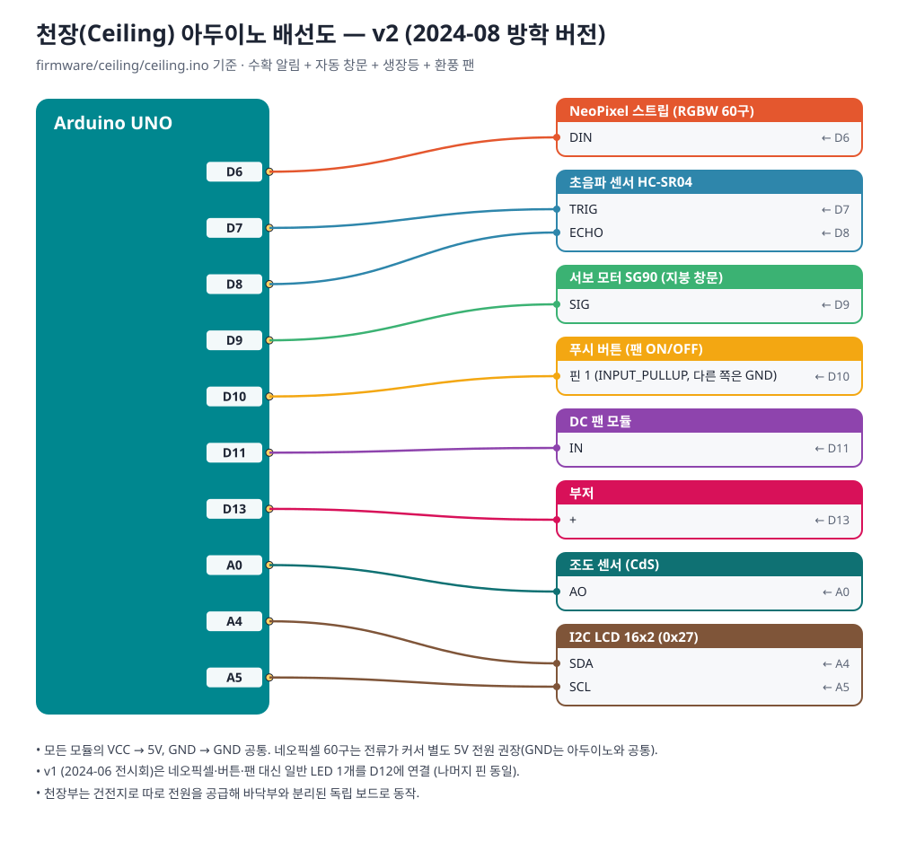</p>
<p align="center">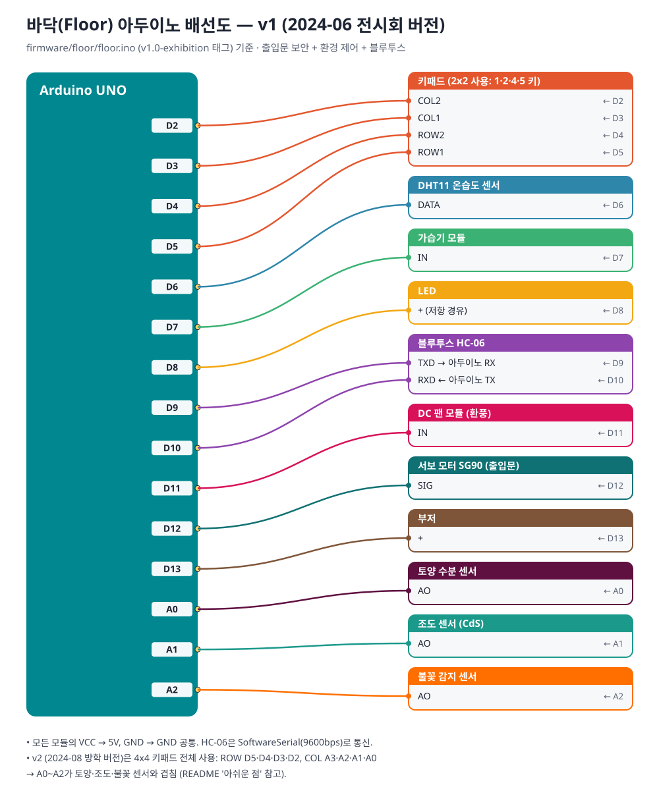</p>

핀 배치표는 [`hardware/README.md`](hardware/README.md)에 정리했습니다.

---

## 🛠️ 제작 과정

| 날짜 | 내용 |
|---|---|
| 05.09 ~ 05.16 | 수업 실습(스마트 도어락, RFID, 서보 제어)으로 기초 다지기 → 키패드 출입문의 출발점 |
| 05.18 | 유튜브 쇼츠의 스마트팜 영상을 보고 주제 결정 |
| 05.22 | 부품 주문 (가습기 모듈, 서보 추가) |
| 05.27 | **마인크래프트로 외관을 먼저 설계** (셀로판을 부채처럼 접어 서보로 여는 지붕 아이디어) |
| 05.30 | 앱 첫 버전, 초음파 침입 감지 테스트 |
| 06.03 ~ 06.06 | 센서·액추에이터 단위 테스트 → 바닥 코드 통합 (센서 → 키패드·DHT·블루투스) |
| 06.05 ~ 06.07 | 하우스 본체·지붕 아치·창틀·환풍구 제작 (밤샘), **아두이노 2대 구조 결정** |
| 06.10 | 앱 화면 디자인 (사이렌·물방울·온도계 아이콘) |
| 06.12 | 천장 코드 완성 (수확 알림 + 창문), 앱 최종 UI |
| **06.13** | **기말 발표 · IoT 전시회 → 1등** |
| 07.18 | 교수님 요청: 학과 홍보영상용 재제작 |
| 08.05 ~ 08.12 | 아크릴·우드락으로 재제작, 네오픽셀·팬 버튼 추가, 블루투스 재연결 |
| **08.13** | **학과 홍보영상 촬영** |

<table>
<tr>
<td align="center">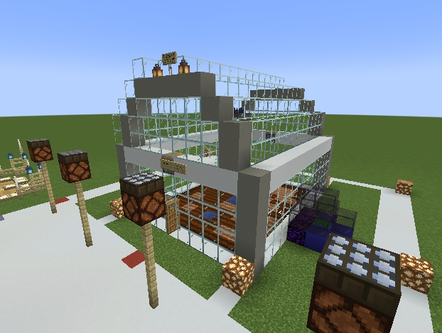<br><sub>마인크래프트로 먼저 설계</sub></td>
<td align="center">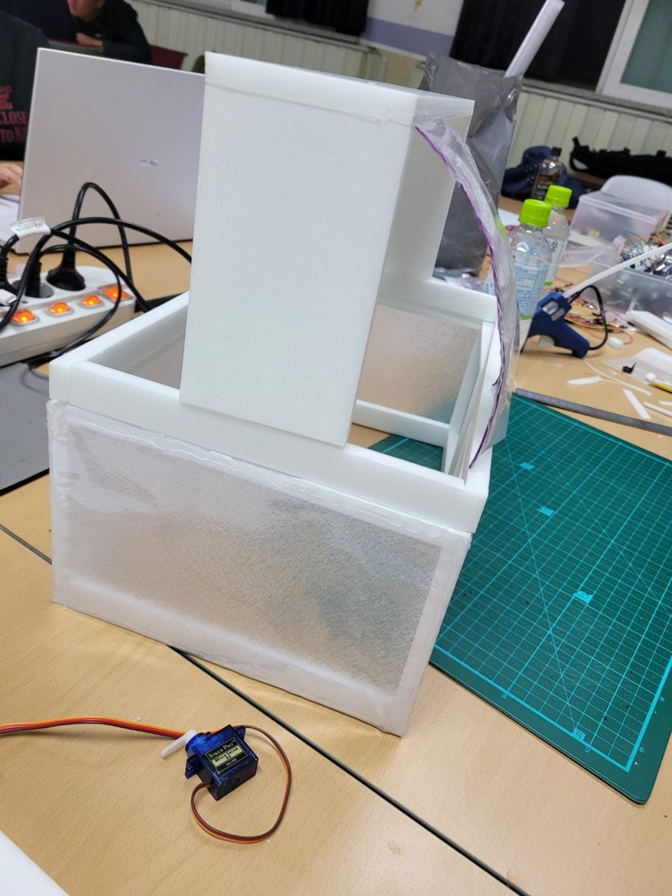<br><sub>지붕 아치 제작</sub></td>
<td align="center">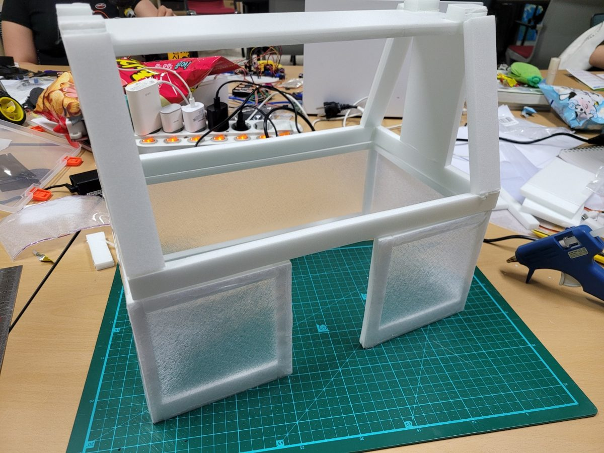<br><sub>본체 골조</sub></td>
</tr>
<tr>
<td align="center">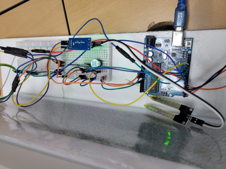<br><sub>바닥부 브레드보드 회로</sub></td>
<td align="center">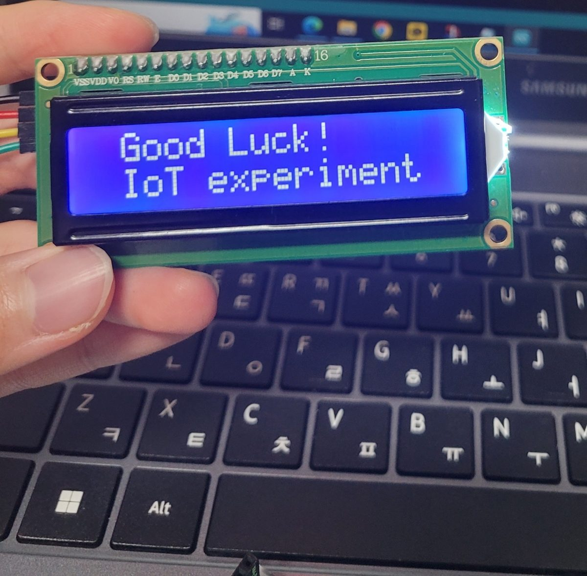<br><sub>LCD 출력 테스트</sub></td>
<td align="center">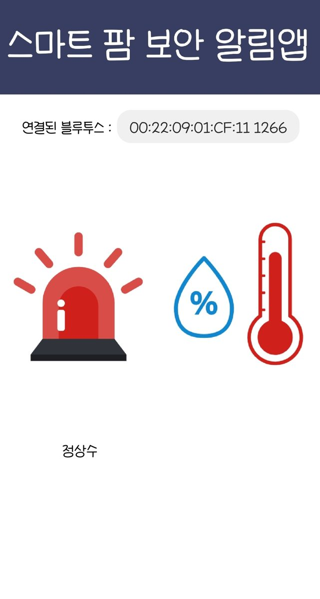<br><sub>앱 최종 화면</sub></td>
</tr>
<tr>
<td align="center" colspan="3">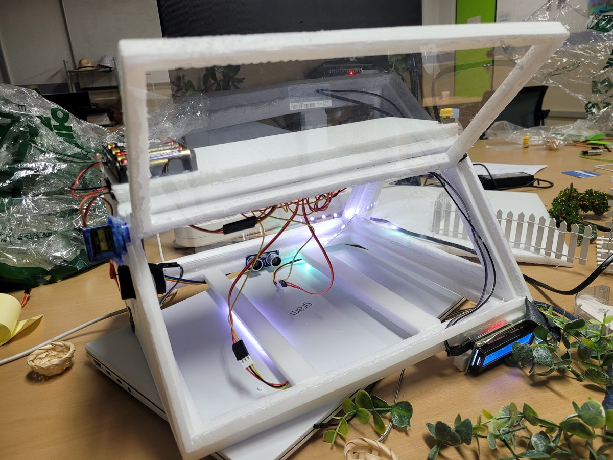<br><sub>v2 재제작: 천장부 네오픽셀 생장등 점등 테스트</sub></td>
</tr>
</table>

---

## 🔄 v1 → v2 변경점

| | v1 · 2024-06 전시회 | v2 · 2024-08 홍보영상 |
|---|---|---|
| 외관 | 폼보드 + 반투명 시트지 | 투명 아크릴 + 우드락, 인조잔디·울타리 |
| 천장 조명 | LED 1개 | **네오픽셀 RGBW 60구** (생장등) |
| 천장 팬 | — | **버튼으로 ON/OFF** |
| 키패드 | 2x2만 배선 (1·2·4·5) | **4x4 전체 배선** |
| 수확 판정 거리 | 10 cm | 4 cm (작물 높이에 맞춰 조정) |
| 코드 | [`v1.0-exhibition` 태그](https://github.com/seojun-1266/smart-farm-iot-2024/tree/v1.0-exhibition/firmware) | [`v2.0-promo` 태그](https://github.com/seojun-1266/smart-farm-iot-2024/tree/v2.0-promo/firmware) (= 현재 `main`) |

커밋 기록에서 바닥 코드가 **센서 통합(06.04) → 키패드·DHT·블루투스 통합(06.05) → 전시회 최종(06.13) → 방학 버전(08.09)** 으로 발전한 과정을 볼 수 있습니다.

---

## 📁 폴더 구조

```
smart-farm-iot-2024/
├── firmware/
│   ├── ceiling/ceiling.ino   천장 아두이노 (수확 알림, 지붕 창문, 네오픽셀, 팬 버튼)
│   ├── floor/floor.ino       바닥 아두이노 (키패드 출입문, 온습도, 급수, 조명, 팬, 블루투스)
│   └── tests/                부품별 단위 테스트 스케치 8개
├── app/
│   ├── SmartFarm.aia         App Inventor 프로젝트 (v1 전시회 최종)
│   └── assets/               앱 아이콘 이미지
├── hardware/                 배선도(SVG)와 핀 배치표
└── docs/                     사진, 시연 GIF
```

### 실행 방법
- **펌웨어**: Arduino IDE에서 각 `.ino`를 열고 라이브러리 설치 후 업로드
  `Keypad` · `DHT sensor library` · `LiquidCrystal I2C` · `Adafruit NeoPixel` · `Servo`(기본) · `SoftwareSerial`(기본)
- **앱**: [MIT App Inventor](https://ai2.appinventor.mit.edu) → 프로젝트 → *내 컴퓨터에서 프로젝트(.aia) 가져오기*

---

## 👥 팀

| 이름 | 역할 |
|---|---|
| **홍서준** (팀장) | 기획, 아두이노 펌웨어 전체, 회로 설계·배선, 앱 동작 로직(블록 코딩), 홍보영상용 재제작 총괄 |
| 문효원 | 외관(본체·지붕·창문) 제작, 앱 화면 디자인, 발표 자료, 홍보영상 출연·설명 |
| 이호현 | 홍보영상용 재제작(2024-08) 외관 꾸미기 보조, 홍보영상 출연 |
| 이은선 | 홍보영상용 재제작(2024-08) 외관 꾸미기 보조 |

---

## 💭 회고

**잘한 점**
- 기능을 부품 단위 테스트(`firmware/tests`)로 먼저 검증한 뒤 하나씩 통합해, 전시 직전 문제를 빨리 찾을 수 있었습니다.
- 지붕이 열리는 구조 때문에 배선이 어렵다는 문제를 **보드를 2대로 나누는 설계**로 해결했습니다.
- 마인크래프트로 외관을 먼저 설계해 팀원끼리 완성 모습을 빠르게 맞출 수 있었습니다.

**아쉬운 점 · 다시 만든다면**
- 비밀번호 입력을 `while`로 기다리는 동안 센서 갱신이 멈춥니다 → `millis()` 기반 상태 머신으로 바꾸고 싶습니다.
- v2에서 4x4 키패드 열 핀(A0~A3)이 토양·조도·불꽃 센서 핀(A0~A2)과 겹칩니다 → 아날로그 입력이 부족해 생긴 문제로, I2C 키패드나 아두이노 메가를 썼다면 피할 수 있었습니다.
- 비밀번호(`1111`)가 코드에 고정되어 있고 블루투스 통신에 인증이 없습니다.
- 두 보드가 서로 통신하지 않아 천장부 상태(수확 알림)는 앱에서 볼 수 없습니다.

<details>
<summary>코드 복원 메모</summary>

- 1학기 전시회 최종 코드(06.12 천장 / 06.13 바닥)는 노트북 교체로 원본이 사라져, 팀원과의 카카오톡 대화에서 복원했습니다.
  복원 과정에서 빠진 `#include <Keypad.h>` 한 줄만 보충했습니다.
- 방학 버전 바닥 코드(08.09 저장본)에는 시리얼 모니터 출력이 실수로 붙여넣어져 있어 그 부분만 제거했습니다.
  홍보영상 촬영 당일(08.12)에 쓴 최종 바닥 코드는 남아 있지 않아, 영상 속 앱 출력 형식과 일부 다를 수 있습니다.
</details>
